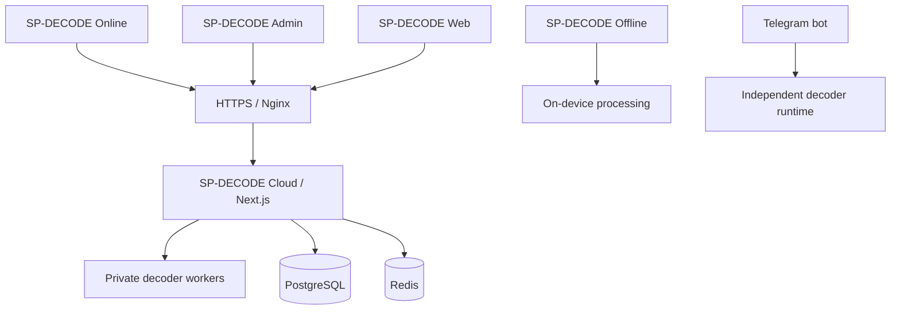

<div align="center">


# SP-DECODE

**Secure configuration processing · Native Android applications · Centralized cloud services**

[](https://spdecode.xyz)


[Official website](https://spdecode.xyz) · [Telegram channel](https://t.me/GhostDeve) · [Community](https://t.me/CodeBreakersHub) · [Documentation](#documentation)

</div>

---

## Overview

SP-DECODE is an integrated platform for processing authorized VPN, proxy and tunneling configurations. It combines native Android applications, a centralized decoding infrastructure, dynamic provider catalogs, account management and administrative tools.

The platform supports structured configuration files, text protocols and provider catalogs through dedicated, version-aware processing engines. Results can be inspected, copied or exported in supported formats without requiring a complete list of file extensions in this README.

## The SP-DECODE ecosystem

| Component | Description |
| --- | --- |
| **SP-DECODE Online** | Cloud-powered Android client for configuration processing, VPN catalogs, accounts and support. |
| **SP-DECODE Offline** | Independent Android edition for supported on-device processing without advertising. |
| **SP-DECODE Admin** | Native Android administration console for authorized operators and support staff. |
| **SP-DECODE Cloud** | Centralized processing, catalog delivery, security, accounts and service infrastructure. |
| **SP-DECODE Web** | Official website, account access, digital products and service information. |
| **SP-DECODE Bot** | Independent Telegram integration for supported files and text protocols. |

### SP-DECODE Online

**Public version: 1.1.28 (build 43).**

- Server-side processing of supported files and text configurations.
- Dynamic VPN and server catalogs, including version notifications and favorites.
- Structured JSON results with copy, export and history features.
- Google sign-in, account management and secure session handling.
- Integrated support conversations, account activity and notifications.
- Digital store, purchases, receipts, licenses and commercial access.
- Unity Ads integration and advertising privacy controls in enabled builds.
- Multilingual interface and AMOLED visual identity.

[Visit the official website](https://spdecode.xyz) for public downloads and information.

### SP-DECODE Offline

A separate edition designed for local processing of supported configurations.

- Native C++ processing with Android integration.
- Local history, structured results and JSON export.
- Customizable appearance and multilingual interface.
- No advertising.

Compatibility and distribution depend on the Offline edition's own release and licensing requirements. Its processing capabilities are not assumed to match the Online catalog.

### SP-DECODE Admin

An independent native application connected to the administrative backend. Access is restricted to authorized accounts and their assigned permissions.

| Area | Capabilities |
| --- | --- |
| Users and access | User search, account details, staff management, custom roles and permissions. |
| Support | Authorized conversations, replies, assignments and ticket management. |
| Commerce | Products, orders, transactions, licenses, API access, gift codes and credit history. |
| Catalogs and notices | Provider controls, catalog notifications and service announcements. |
| Operations | Service status, audit records, maintenance and cleanup requests. |
| Security | Authenticated sessions, staff password management and remote sign-out. |

The release build uses native C++/JNI networking, encrypted session storage, R8 and the existing permanent signing identity. Deployment requires a compatible backend and valid administrative credentials.

### SP-DECODE Cloud and Web

The centralized infrastructure provides:

- Private processing workers and modular Python, Node.js and PHP engines.
- Dynamic catalog delivery and provider availability controls.
- Account authentication and role-based administrative access.
- PostgreSQL for persistent commercial and account records.
- Redis for caching, sessions and operational state.
- Digital products, commercial API access and payment-provider integrations.
- Service notices, support workflows, monitoring and deployment controls.

Commercial services depend on configured providers, entitlement rules and production enablement. APK analysis is not presented as an available public Online feature.

### SP-DECODE Bot

The Telegram integration remains available as an independent component for supported configuration files, text protocols, access-controlled processing and multipart sessions. It has its own installation and service commands.

---

## Security and infrastructure

| Layer | Design |
| --- | --- |
| Transport | HTTPS/TLS and HPKE V2 (X25519) for the Online processing transport. |
| Android | Native C++/JNI boundaries, Android Keystore and encrypted session storage where applicable. |
| Access | Server-side authorization, scoped roles, session expiration and revocation. |
| Integrity | Device attestation and integrity controls for protected Online operations. |
| Release | R8 optimization and permanent Android signing for configured release builds. |
| Infrastructure | Private workers, restricted services, controlled deployment and persistent data. |

Operational secrets, signing keys and production credentials must remain outside version control. Only process configurations that you own or are explicitly authorized to inspect.

## Architecture



Online processing, administrative operations, offline processing and the Telegram integration have distinct execution and access boundaries.

## Technology stack

<div align="center">

&nbsp;&nbsp;
&nbsp;&nbsp;
&nbsp;&nbsp;
&nbsp;&nbsp;
&nbsp;&nbsp;


&nbsp;&nbsp;
&nbsp;&nbsp;
&nbsp;&nbsp;
&nbsp;&nbsp;
&nbsp;&nbsp;


</div>

| Environment | Technologies |
| --- | --- |
| Android | Kotlin, Jetpack Compose, C++, JNI, Android NDK, Gradle |
| Cloud and web | Next.js, Node.js, Python, PHP |
| Data | PostgreSQL, Redis |
| Operations | Docker Compose, Nginx, Linux, GitHub Actions |
| Mobile services | Firebase Cloud Messaging, Google authentication, Unity Ads |

---

## Deployment and server management

The Cloud service uses `spdecode`. The standalone VPS bot uses `spdecode-telegram`
for its management command and systemd service.

### Cloud: first installation

Use an Ubuntu or Debian VPS, a configured domain with the required DNS records, HTTPS and adequate resources. Review the installer before execution, especially its deployment ref and configuration requirements. Use the existing deployment and update procedure on a server that is already installed.

```bash
git clone --branch ci/unity-ads-online-qa https://github.com/gokussj092/NSKSDKLDLDLDMDNDNDNNDNDNDNDNDNDNDNDNDMDM.git SP-DECODE
cd SP-DECODE
sudo bash cloud/infra/vps/install.sh --domain example.com --email admin@example.com --ref ci/unity-ads-online-qa
```

Replace the illustrative domain and administrator email with your authorized deployment values. Where repository access requires authentication, configure it before installation; the installer supports an authorized SSH setup. Complete the provisioning and security configuration before enabling public services.

### Status and diagnostics

```bash
sudo spdecode help
sudo spdecode status
sudo spdecode panel check
sudo spdecode logs all
sudo spdecode logs worker
```

### Updates

```bash
# Full Cloud update
sudo spdecode update all ci/unity-ads-online-qa

# Web/API and administrative backend only
sudo spdecode update web ci/unity-ads-online-qa

# Decoder worker only
sudo spdecode update worker ci/unity-ads-online-qa
```

Choose the scope that matches the change; these are alternatives, not a sequence. Take appropriate data backups and inspect the target revision before deploying.

> [!IMPORTANT]
> On the optimized production VPS, preserve the local Compose resource override and installed CLI adjustments before updating or rolling back. The automatic preservation of those resource settings is not yet implemented in the repository updater. Verify that the settings are still applied after deployment. See the [production operations notes](docs/PRODUCTION_VPS_OPTIMIZATION_2026_11_14.md).

### Service administration

```bash
sudo spdecode restart web
sudo spdecode restart worker
sudo spdecode restart all
sudo spdecode providers status
sudo spdecode cleanup status
```

### Backups and recovery

```bash
sudo spdecode backup
# Roll back to the recorded previous revision when needed
sudo spdecode rollback
```

The built-in backup command saves deployment configuration and the current revision; it is not a full PostgreSQL, Redis or volume backup. Maintain encrypted off-server backups of persistent data and required keys, and test restoration. Rollback is an operational recovery action, not a routine update step.

### Administrative panel and commerce

```bash
sudo spdecode panel check
sudo spdecode panel sync-routes
sudo spdecode commerce status
```

The following commands are reserved for authorized operators when explicitly needed:

```bash
sudo spdecode panel enable
sudo spdecode panel reset-admin
sudo spdecode commerce migrate
```

Resetting administrative credentials and applying database migrations are intentional administrative actions; review their impact before execution.

### Android artifact publication

```bash
sudo spdecode android public-status online
sudo spdecode android public-build online --ci-run SUCCESSFUL_RUN_ID
# Restore the previous published build when necessary
sudo spdecode android public-rollback online
```

Replace the placeholder with an eligible successful CI run ID. Publication is gated by the configured release workflow and permanent signing requirements. Offline publication has its own release gates. The Admin application uses its independent [signed release workflow](.github/workflows/android-admin-release.yml).

### Telegram bot: Termux and Linux

Run the installer from a checkout dedicated to the standalone bot:

```bash
# Termux
bash installers/install-termux.sh

# Linux VPS
bash installers/install-vps.sh
```

On the VPS, run the installer and bot updates from the account that owns the
bot checkout. A root login shell, including one opened with `sudo -i`, can
install and manage its own checkout in `/root/spdecode-telegram`.
The installer prompts for the BotFather token on the terminal with echo
disabled and reuses an existing bot configuration. The default
administrator ID is `5325631223` when administrator configuration is omitted.
Manage or update the installed VPS bot with:

```bash
spdecode-telegram status
spdecode-telegram start
spdecode-telegram stop
spdecode-telegram restart
spdecode-telegram logs
spdecode-telegram config
spdecode-telegram update
```

The updater fast-forwards the bot's checkout, refreshes dependencies when their
manifests change, validates startup, and starts the bot. It checks that the
systemd process stays active before reporting success and starts an inactive
service even when the checkout is already up to date.
The Termux launcher uses `spdecode` on the device.

In Telegram, reply to the bot's credential prompt in the same chat and
topic as the original file or link. The bot replies with a Markdown attachment
that shows the application, sender, original message date and time in UTC,
and the official channel, group, and developer links. The Telegram caption
also shows the application, sender, and timestamp. For file uploads the bot
replaces the original extension with `.md`. Text and link results prefix
`spdecode-result.md` with the app name, as in `V2Box-spdecode-result.md`.
Copy numbers after the input extension are supported. Both `profile.hc (1)`
and `profile.hc(1)` use the HTTP Custom decoder and keep the copy number in
the result filename. Each attachment contains one formatted JSON block labeled
for syntax highlighting in compatible Markdown viewers. Plain-text decoder
output is stored in the `text` field. Unsupported inputs, failed decodes, and
incomplete SSC Custom and Dark Tunnel fragments are handled silently.
Administrators can manage access without a restart.

- `/allowgroup [GROUP_ID]` adds the current group or a specific group to the allowlist.
- `/revokegroup [GROUP_ID]` removes a group from the allowlist.
- `/restrictgroups` disables all-groups access and enforces the saved allowlist.
- `/private` checks your private access. Administrators see the list and can
  use `/private allow USER_ID` or `/private revoke USER_ID`.


---

## Repository structure

```text
SP-DECODE/
├── android/          # Android application source
├── android-admin/    # Native administrative application
├── cloud/
│   ├── web/           # Public site and backend
│   ├── workers/       # Private processing services
│   ├── accounts/      # Account infrastructure
│   ├── attestation/   # Device trust services
│   ├── contracts/     # API contracts
│   └── infra/         # Deployment and operations
├── decoders/         # Modular processing engines
├── installers/       # Standalone bot installers
├── scripts/          # Validation and management utilities
├── spdecode/         # Telegram integration
├── website/          # Additional web resources
├── docs/             # Technical documentation and runbooks
├── tests/            # Regression and contract tests
└── README.md
```

## Validation

From the repository root:

```bash
python3 validate_project.py
python3 -m unittest discover -s tests -v
sh android-admin/tests/run-native.sh
sh android-admin/tests/run-jni-host.sh
```

Cloud web checks, from a configured development environment:

```bash
cd cloud/web
npm ci --no-audit --no-fund
npm test
npm run build
```

Release workflows additionally validate Android build artifacts, signing, native compatibility and relevant automated tests. Automated tests do not establish compatibility with every third-party exporter or replace authenticated production and physical-device testing.

## Documentation

| Resource | Description |
| --- | --- |
| [Android Admin](android-admin/README.md) | Application architecture, access and release requirements. |
| [Android Admin validation](android-admin/VALIDATION.md) | Test coverage and production prerequisites. |
| [Online account and support](docs/commerce/ONLINE_QA_AUTH_SUPPORT_UPDATER.md) | Authentication, support and account integration. |
| [Notifications and roles](docs/commerce/ONLINE_PUSH_ACTIVITY_ROLES_QA.md) | Private notifications, activity and role management. |
| [AI maintenance incident guide (18 Nov 2026)](docs/cloud/INCIDENTE_V2_ANDROID_CLOUD_Y_CATALOGO_2026_11_18.md) | Root cause of V2 session HTTP 400, Hex Custom Cloud, quota isolation and prevention checklist for AI collaborators. |
| [Catalog operations](docs/cloud/CATALOGS_UPDATE_RUNBOOK.md) | Catalog maintenance and deployment. |
| [Transport security](docs/V2_HPKE_TRANSPORT.md) | Secure Online transport. |
| [Production operations](docs/PRODUCTION_VPS_OPTIMIZATION_2026_11_14.md) | VPS resources, persistence and updater requirements. |
| [Technical documentation](docs/) | Additional implementation, compatibility and operational references. |

## Compatibility and responsible use

Supported formats and catalogs evolve continuously. Availability can vary by application version, configuration variant, account permissions and provider status. Unsupported or protected inputs remain subject to their respective compatibility and authorization requirements.

Report reproducible issues through the support channels without sharing private credentials, configuration secrets or personal information.

## Official links and credits

| Resource | Link |
| --- | --- |
| Official website | [spdecode.xyz](https://spdecode.xyz) |
| Telegram channel | [@GhostDeve](https://t.me/GhostDeve) |
| Community | [@CodeBreakersHub](https://t.me/CodeBreakersHub) |
| GitHub | [gokussj092](https://github.com/gokussj092) |

Created and maintained by **Ghost Developer**. Third-party software, libraries and trademarks remain the property of their respective owners.

---

<div align="center">

**SP-DECODE**

Native clients. Secure processing. Centralized infrastructure.

Made by [Ghost Developer](https://github.com/gokussj092).

</div>
